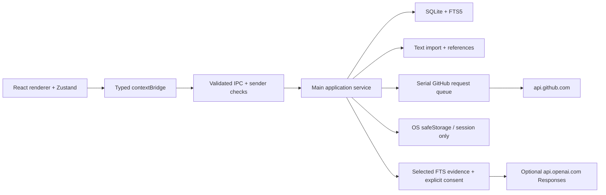

# Architecture

OSS Compass uses Electron because the project needs a desktop window, native file dialogs, local SQLite, encrypted credential access, and offline operation without a hosted backend.

## Process boundaries

`src/main/index.ts` owns the window, database, native dialogs, external links, permission policy, and periodic synchronization. The renderer cannot import Node modules. `src/preload/index.ts` exposes only `snapshot(query?)` and `act(action)`. `src/shared/types.ts` describes the action union; Zod validates it again in the main process. IPC requires the current window, its main frame, and the exact production file URL (or development origin).

`src/main/service.ts` coordinates records, imports, private state, reports, and deterministic conversation responses. React screens use a small Zustand store that refreshes from the authoritative main-process snapshot. Three-second polling shows synchronization state without leaking Electron events. Mutations persist before refreshing the UI.

## Persistence

SQLite WAL and foreign keys are enabled. Migration 1 establishes settings, repositories, items, sources, tasks, conversations, changes, HTTP cache, prompt templates, and the FTS5 index. Migration 2 adds synchronization checkpoints. Migration 3 scopes disposable HTTP cache rows to a literal repository owner. Migration 4 adds transactional evidence chunks in a separate FTS5 index. JSON aggregates preserve nested comments, reviews, source segments, references, annotations, and conversation messages; indexed relational keys support repository ownership and deletion. This intentionally avoids dozens of premature tables in the first desktop MVP. See [schema](docs/architecture/DATABASE.md).

Every aggregate upsert updates its FTS entry in one transaction. GitHub refreshes preserve private notes, saved state, and private review state, note head anchors, and inspection history. Source IDs, item keys (`owner/repo#number`), UUID conversations/messages, timestamps, and provenance travel with their records. A whole successful repository snapshot is committed transactionally. Failed syncs retain previous records and show the error.

## GitHub and change detection

One centralized queue bounds concurrency to one request. Lists use Link pagination with a configurable record ceiling, conditional ETag responses, 20-second request timeouts, three transient-error attempts, and cancellation. Redirects are manually checked and restricted to approved paths at api.github.com. GitHub issue-endpoint PRs are filtered before storage.

Issues use a conservative completed-list checkpoint with a one-minute overlap; truncated issue lists do not advance it. PRs use a bounded recently-updated list. A maximum of 12 item discussions is enriched per sync, with bounded comments/reviews/checks. Optional enrichment is deferred at eight remaining API requests to preserve core access for other repositories; partial coverage and the reason are visible. A bounded discovery pass checks root, .github and docs for up to 12 supported contributor, governance, ownership and AI policy documents. Each location/document carries observation and availability metadata. Absent files are normal; permission and detail failures are visible. Closed items are updated when returned, not guessed closed because absent from a page.

First synchronization establishes a baseline. Later newly observed IDs, state/update/review changes, and imported explicit references produce change events. The briefing presents recent events and explainable investigation opportunities. It is not a push-notification scheduler or an exhaustive GitHub activity ledger.

After an explicit initial sync, repositories older than 30 minutes are eligible for background refresh while the app is running. There is no background service after app exit.

## Community and conversations

Native file import checks extension, size, and content before parsing. Manual/pasted records are explicitly unverified; imported records retain source/date/timestamps. Explicit GitHub URLs and `owner/repo#N` resolve only to tracked repositories. Bare `#N` needs a selected repository. Keyword overlap creates a separate unverified candidate. Users classify exact passages; no automatic priority endorsement is inferred.

Chat defaults to an offline deterministic evidence assistant. It stores user interactions and source references with `user`, `deterministic`, `model`, and `demo` origins. The optional OpenAI adapter accepts only a main-process preview token bound to exact selected evidence and explicit cloud consent. It stores model/usage metadata and supplied chunks; no tools or GitHub writes exist. See [optional AI boundaries](docs/architecture/OPTIONAL_AI.md). Demo conversations are read-only and excluded when demo visibility is off.

## Build

Electron Vite creates separate main, CJS sandbox-compatible preload, and renderer bundles. Better-sqlite3 stays external and is unpacked from ASAR. electron-builder rebuilds its native ABI for the target Electron release. Windows NSIS configuration and Windows CI are provided; local validation uses the available macOS arm64 host. See README for packaging commands and signing limitations.

## Design references consulted

- [Electron sandbox and preload](https://www.electronjs.org/docs/latest/tutorial/sandbox)
- [Electron safeStorage](https://www.electronjs.org/docs/latest/api/safe-storage)
- [Electron Vite setup](https://electron-vite.org/guide/)
- [GitHub API best practices](https://docs.github.com/en/rest/using-the-rest-api/best-practices-for-using-the-rest-api)
