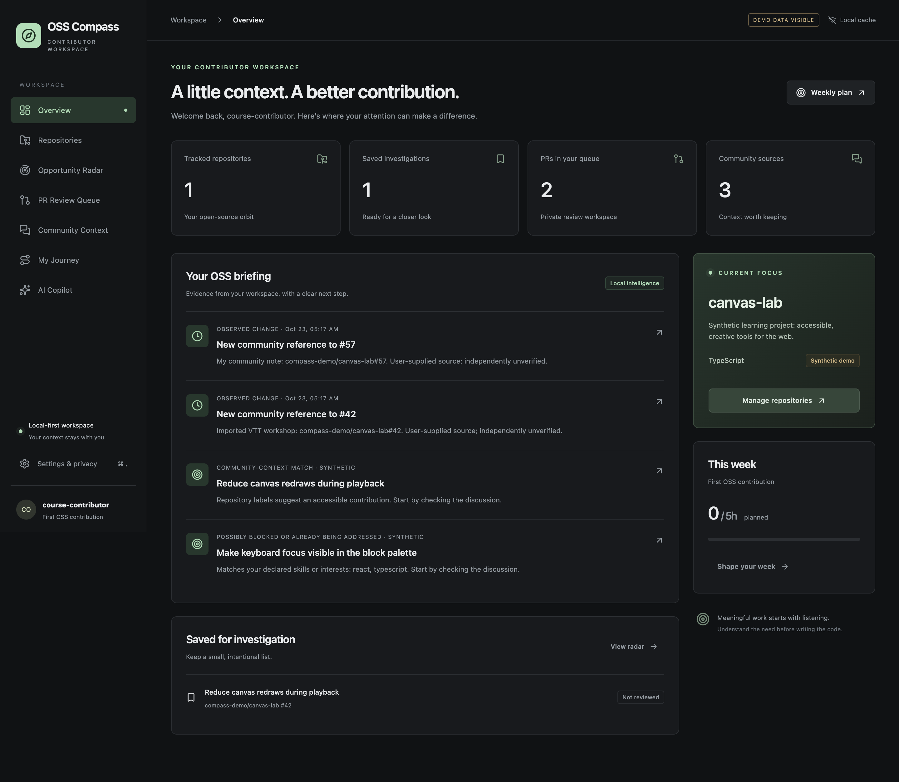

# OSS Compass

A local-first Electron workspace for meaningful open-source contribution. Track public GitHub repositories, investigate issues, triage PRs privately, connect authorized community context, and plan realistic work.



## Run

Requires Node.js 22.12+ (Node 22 LTS recommended), npm, and a desktop session.

```sh
npm ci
npm run dev
```

Complete onboarding, then add `owner/repo` in Repositories and click **Synchronize**. No token is required for public repositories. For offline exploration, click **Load demo data**. Synthetic records are visibly labeled and can be hidden in Settings.

```sh
npm run typecheck
npm run lint
npm test
npm run test:e2e
npm run build
npm run package:mac
# On Windows:
npm run package:win
```

`npm test` rebuilds SQLite for Node. Before running Electron afterward, use `npm run native:electron`; `test:e2e` and packaging perform the appropriate rebuild. See [SETUP](SETUP.md).

## Implemented

- React desktop UI with onboarding, dark/light themes, eight workspaces, detail panels, and keyboard navigation.
- Public GitHub metadata, bounded paginated issue/PR synchronization, discussions, review entries, check runs where accessible, and evidence-linked guidance from root, .github and docs.
- Single request queue, timeouts, cancellation, retries, ETags, conservative incremental checkpoints, rate-limit errors, and cached/offline access.
- SQLite migrations, FTS5, preserved investigation notes, saved items, local PR review states and persistent inspection history, and change events that suppress first-sync notifications.
- Explainable opportunity ranking using skills, labels, assignments, activity, description, explicit community references, and explicit related/previous PR signals, with a Before You Start coverage assessment.
- Manual notes, pasted messages, link research, TXT/MD/SRT/VTT and Slack channel JSON exports; explicit references, unverified candidates, passage classification, and search.
- Capacity-limited weekly planning, manual deadlines, user-entered achievements, and factual Markdown reports.
- Persistent conversations with rename/delete/search/export, selected-source deterministic responses, optional consent-gated OpenAI responses with cited evidence, and separately labeled synthetic demo conversations.
- Validated preload IPC, isolated sandboxed renderer, safe Markdown, restricted API destinations, and OS-encrypted or session-only GitHub/OpenAI credentials.

## Scope and honesty

The default assistant is deterministic and local. Version 0.2 adds an optional OpenAI provider with evidence preview, per-request consent and usage controls. No live OpenAI call was made during validation; contract/privacy behavior was tested with controlled responses. See [optional AI](docs/architecture/OPTIONAL_AI.md). No Slack/Discord bots, automatic reviews, merges, posting or telemetry are included. The original vision remains in [the user brief](docs/ai/MASTER_BUILD_PROMPT.md), with current boundaries in [known limitations](docs/course/KNOWN_LIMITATIONS.md).

The [post-Codex audit](docs/audits/POST_CODEX_AUDIT.md) records verified repairs and benchmark evidence. Devin access was unavailable; [no Devin scans or remediations ran](docs/audits/DEVIN_SCAN_REPORT.md).

Public GitHub data is always a **cached observation**, not a guarantee of current state. Synchronization budgets are explicit; large repositories show partial coverage. Manual notes are not verified transcripts. A reference does not prove maintainer endorsement.

## Course evidence

Start with [the project overview](docs/course/PROJECT_OVERVIEW.md), [demo walkthrough](docs/course/DEMO_WALKTHROUGH.md), [testing report](docs/course/TESTING_REPORT.md), [actual Git milestones](docs/course/GIT_MILESTONES.md), and [development journal](docs/development-journal/2026-10-22.md). AI assistance is disclosed in [docs/ai](docs/ai/AI_USAGE_DISCLOSURE.md). No earlier history has been invented.

See [ARCHITECTURE](ARCHITECTURE.md), [SECURITY](SECURITY.md), [TESTING](TESTING.md), and [CONTRIBUTING](CONTRIBUTING.md).
